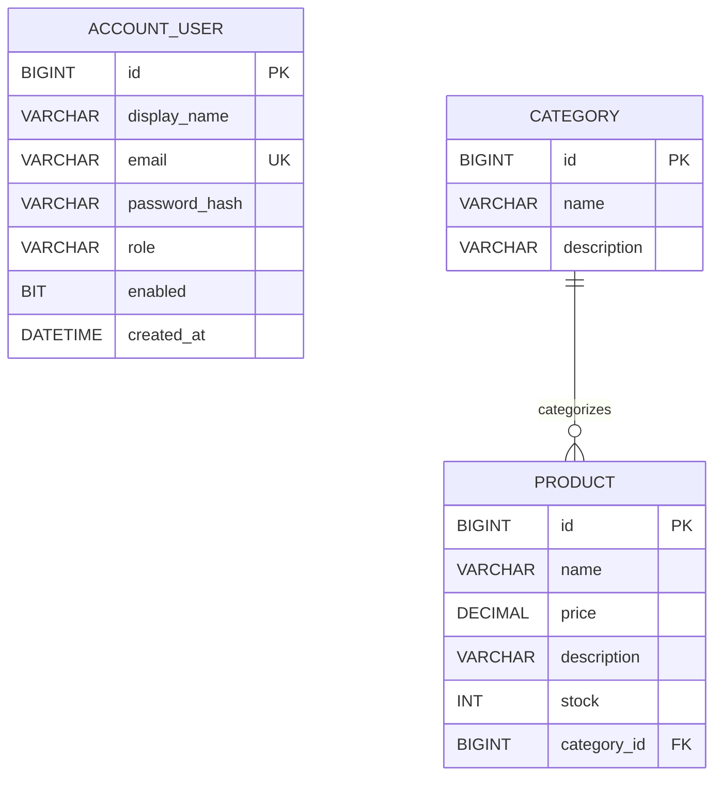

# ShopSphere — Thiết kế cơ sở dữ liệu hiện tại

> Mô tả các entity đã triển khai. Cập nhật: 2026-10-23.

## Hệ quản trị và schema

- Microsoft SQL Server (Compose dùng SQL Server 2022 Express).
- Spring Data JPA/Hibernate; `spring.jpa.hibernate.ddl-auto=update`.
- Chưa có Flyway/Liquibase migration; backup dữ liệu trước khi đổi entity.

## ERD

Kiểu SQL chính xác do Hibernate mapping quyết định; sơ đồ trên thể hiện logic, không thay thế schema thực tế.

## `AccountUser` — bảng `app_users`

| Thuộc tính | Quy tắc |
| --- | --- |
| `id: Long` | Khóa chính, `IDENTITY` |
| `displayName: String` | Tên hiển thị, bắt buộc, tối đa 120 ký tự qua request |
| `email: String` | Bắt buộc, duy nhất, dùng làm username |
| `passwordHash: String` | BCrypt hash, không lưu password thô |
| `role: AccountRole` | Enum lưu dạng chuỗi: CUSTOMER, SELLER, ADMIN, SHIPPER |
| `enabled: boolean` | Tài khoản được phép đăng nhập hay không |
| `createdAt: LocalDateTime` | Thời điểm khởi tạo |

Role lưu trong bảng user, chưa có bảng role riêng. Đăng ký công khai chỉ tạo Customer; Admin có thể được bootstrap qua environment. Chưa có luồng cấp Seller/Shipper.

## `Category`

- `id: Long`: khóa chính sinh tự động.
- `name: String`: tên bắt buộc không rỗng.
- `description: String`: tùy chọn.

## `Product`

- `id: Long`: khóa chính sinh tự động.
- `name: String`: tên bắt buộc không rỗng.
- `price: BigDecimal`: bắt buộc, tối thiểu `0.01`.
- `description: String`: tùy chọn.
- `stock: Integer`: bắt buộc, từ 0 trở lên.
- `category: Category`: quan hệ `ManyToOne`, lazy, khóa ngoại `category_id`.

API yêu cầu category ID dương và service xác nhận danh mục tồn tại khi tạo/sửa sản phẩm. Entity hiện không khai báo unique cho tên danh mục/sản phẩm và không bật cascade delete.

## Hành vi xóa và dữ liệu chưa có

- Xóa product không tồn tại trả 404.
- Xóa danh mục đang được tham chiếu có thể bị SQL Server từ chối do khóa ngoại; API chưa ánh xạ thành lỗi nghiệp vụ riêng. UI chặn thao tác nếu còn sản phẩm.
- Chưa có bảng store/cart/order/payment/shipment, lịch sử tồn kho hoặc audit log.
