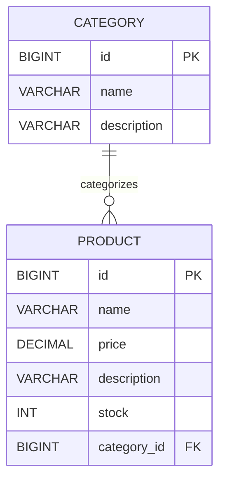

# ShopSphere — Thiết kế cơ sở dữ liệu hiện tại

> Tài liệu phản ánh hai entity đã triển khai. Các bảng marketplace từng đề xuất trước đây chưa có trong ứng dụng. Cập nhật: 2026-10-23.

## Hệ quản trị và quản lý schema

- Microsoft SQL Server (Compose dùng SQL Server 2022 Express).
- Spring Data JPA và Hibernate ánh xạ entity.
- `spring.jpa.hibernate.ddl-auto=update`; Hibernate cập nhật schema khi ứng dụng khởi động.
- Chưa có Flyway/Liquibase migration. Sao lưu dữ liệu trước khi thay đổi entity/schema.

## ERD hiện tại

Tên cột SQL cụ thể do quy ước naming của Hibernate tạo ra; entity chỉ khai báo tường minh `category_id` cho khóa ngoại. Kiểu và độ dài vật lý cần kiểm tra trên schema SQL Server thực tế nếu cần tài liệu mức migration.

## Entity

### `Category`

| Thuộc tính Java | Ý nghĩa |
| --- | --- |
| `id: Long` | Khóa chính, sinh tự động bằng `IDENTITY` |
| `name: String` | Tên danh mục, không được để trống |
| `description: String` | Mô tả tùy chọn |

### `Product`

| Thuộc tính Java | Ý nghĩa |
| --- | --- |
| `id: Long` | Khóa chính, sinh tự động bằng `IDENTITY` |
| `name: String` | Tên sản phẩm, không được để trống |
| `price: BigDecimal` | Giá lớn hơn 0 |
| `description: String` | Mô tả tùy chọn |
| `stock: Integer` | Tồn kho từ 0 trở lên |
| `category: Category` | Quan hệ `ManyToOne`, tải lazy, khóa ngoại `category_id` |

API yêu cầu `categoryId` dương và service xác nhận danh mục tồn tại khi tạo/cập nhật sản phẩm. Entity hiện không khai báo unique constraint cho tên danh mục/sản phẩm, cũng không khai báo `nullable=false` cho quan hệ category.

## Hành vi xóa

- Xóa sản phẩm theo ID; ID không tồn tại trả về 404.
- Xóa danh mục tìm entity rồi gọi repository delete. Nếu còn sản phẩm tham chiếu, kết quả phụ thuộc ràng buộc khóa ngoại của database và có thể thất bại; UI hiện chặn thao tác khi sản phẩm vẫn thuộc danh mục đó.
- Không cấu hình cascade delete.

## Quy tắc validation

- Tên sản phẩm/danh mục không được rỗng.
- Giá là bắt buộc và tối thiểu `0.01`.
- Tồn kho là bắt buộc và không âm.
- `categoryId` của request sản phẩm là bắt buộc, dương và phải trỏ tới danh mục có thật.

## Chưa có trong schema

Không có bảng user/role/store/cart/order/payment/shipment, lịch sử tồn kho hay audit log. Các cấu trúc này chỉ được thiết kế khi tính năng tương ứng được triển khai và chốt quy tắc nghiệp vụ.
