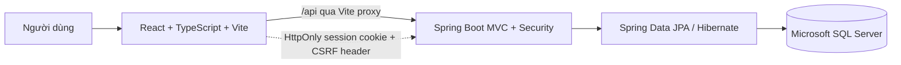

# ShopSphere — Kiến trúc hiện tại

> Mô tả cấu trúc đang chạy trong repository. Marketplace chưa được triển khai. Cập nhật: 2026-10-23.

## Tổng quan

ShopSphere là web client-server: React SPA gọi REST API Spring Boot; Spring Data JPA/Hibernate truy cập SQL Server. Spring Security duy trì phiên đăng nhập phía server.

Frontend chạy riêng bằng Vite; Compose chỉ chạy API và SQL Server. Proxy `/api` mặc định tới `localhost:8081`; Compose map host port `8081` vào container port `8080`. Chạy Maven trực tiếp mặc định dùng `8080`.

## Xác thực và phân quyền

- `/api/auth/register` tạo Customer; đăng nhập tạo HTTP session và lưu SecurityContext trong session.
- Browser giữ session cookie `HttpOnly`, `SameSite=Lax`; `Secure` cấu hình bằng `SESSION_COOKIE_SECURE` (false local HTTP, true khi dùng HTTPS).
- CSRF token lưu trong session. Frontend lấy token từ `/api/auth/csrf` và gửi header tương ứng với POST/PUT/DELETE.
- Password hash bằng BCrypt.
- Public chỉ đọc sản phẩm `ACTIVE`; Admin quản lý toàn bộ catalog, Seller đã duyệt chỉ quản lý sản phẩm thuộc mình và sản phẩm mới/chỉnh sửa phải qua kiểm duyệt.
- Tài khoản Admin tùy chọn được bootstrap qua `SHOPSPHERE_ADMIN_EMAIL` và `SHOPSPHERE_ADMIN_PASSWORD`.
- Role `CUSTOMER`, `SELLER`, `ADMIN`, `SHIPPER` được lưu trên account; chỉ Customer registration và Admin bootstrap có luồng cấp role hiện tại.

## Cấu trúc backend

Backend dùng phân tầng, chưa phải modular monolith domain:

| Package | Trách nhiệm |
| --- | --- |
| `controller` | REST endpoint cho auth, product và category |
| `dto` | Request/response model |
| `service` | CRUD nghiệp vụ và tải user details |
| `repository` | Spring Data JPA repositories |
| `entity` | AccountUser, Product, Category và AccountRole |
| `config` | Security filter chain, password encoder, admin bootstrap |
| `exception` | Lỗi tài nguyên không tồn tại và validation |

Luồng catalog: HTTP → controller → service → repository → SQL Server. Luồng đăng nhập xác thực bằng AuthenticationManager, đổi session ID để chống session fixation, rồi lưu SecurityContext vào session.

## Dữ liệu

- `AccountUser`: tên, email duy nhất, BCrypt hash, role, enabled, createdAt.
- `Category`: tên, mô tả.
- `Product`: tên, giá, mô tả, URL ảnh, stock, Category, Seller sở hữu và moderation status.
- Hibernate `ddl-auto=update`; chưa dùng migration versioned.

## Lỗi và quyền

- Validation lỗi: 400.
- Không tìm thấy catalog entity: 404.
- Chưa đăng nhập: 401; thiếu role: 403.
- Xóa thành công: 204.

## Local deployment và giới hạn

Docker Compose chạy SQL Server 2022 Express và backend; frontend chạy `npm run dev`. `.env.docker` cung cấp secrets. Cấu hình này dành cho local development, chưa phải production deployment.

Đã có Seller ownership checks và API kiểm duyệt sản phẩm; giao diện quản lý catalog theo Seller và Admin chưa hoàn thiện. Chưa có cấp tài khoản Shipper, session store dùng chung, rate limiting, production reverse proxy, frontend production container, backup policy hoặc nghiệp vụ đặt hàng.
