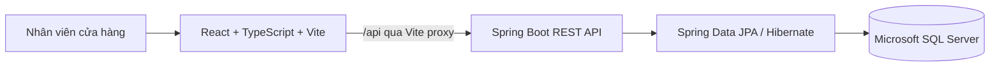

# ShopSphere — Kiến trúc hiện tại

> Mô tả cấu trúc đang được triển khai trong repository. Các module marketplace như checkout và thanh toán chưa tồn tại. Cập nhật: 2026-10-23.

## Tổng quan

ShopSphere là ứng dụng web quản lý sản phẩm theo mô hình client-server. React gọi REST API Spring Boot; backend dùng Spring Data JPA để đọc/ghi SQL Server.

Khi chạy bằng Compose, Vite không nằm trong Compose: frontend được chạy riêng bằng `npm run dev`. Compose chỉ khởi chạy API và SQL Server. Proxy frontend mặc định trỏ tới `http://localhost:8081`; Compose map host `8081` tới cổng ứng dụng `8080` bên trong container. Chạy backend trực tiếp bằng Maven dùng cổng `8080` mặc định.

## Cấu trúc backend

Backend hiện dùng phân tầng đơn giản, chưa phải modular monolith theo domain:

| Package | Trách nhiệm |
| --- | --- |
| `controller` | REST routes `/api/products` và `/api/categories` |
| `dto` | Request/response cho sản phẩm, danh mục và lỗi |
| `service` | CRUD và chuyển đổi entity sang response |
| `repository` | Spring Data JPA repositories |
| `entity` | Hai entity `Product` và `Category` |
| `exception` | Lỗi tài nguyên không tồn tại và xử lý validation |

Luồng xử lý: HTTP request → controller → service → repository → SQL Server; kết quả được chuyển thành DTO JSON.

## Mô hình dữ liệu

- `Category` có `id`, `name`, `description`.
- `Product` có `id`, `name`, `price`, `description`, `stock` và quan hệ `ManyToOne` tới `Category`.
- Response sản phẩm chứa thêm `categoryId` và `categoryName`.
- ID do SQL Server sinh theo `IDENTITY`.
- Hibernate `ddl-auto=update` tự cập nhật schema. Dự án hiện chưa dùng Flyway/Liquibase.

## Xử lý lỗi

- Không tìm thấy sản phẩm/danh mục: `404 Not Found` với `ErrorResponse`.
- Request vi phạm Jakarta Validation: `400 Bad Request`, gồm `fieldErrors`.
- Xóa thành công: `204 No Content`.

## Triển khai phát triển

`docker-compose.yml` định nghĩa hai service:

- `db`: SQL Server 2022 Express, health check, volume `sqlserver-data`, bind cổng host `127.0.0.1:1433`.
- `app`: image dựng từ `Dockerfile`, chờ database khỏe trước khi khởi động và bind host `127.0.0.1:8081`.

Thông tin kết nối và mật khẩu lấy từ `.env.docker`, file này không được commit. Có thể chạy backend ngoài Docker bằng Maven nếu cung cấp `DB_URL`, `DB_USERNAME`, `DB_PASSWORD` phù hợp.

## Giới hạn hiện tại

Chưa có authentication/authorization, phân trang, tìm kiếm phía server, migration versioned, frontend production deployment, logging/metrics tập trung hoặc module nghiệp vụ đặt hàng. Tìm kiếm/lọc hiện được thực hiện trong bộ nhớ ở frontend sau khi tải toàn bộ danh sách.
